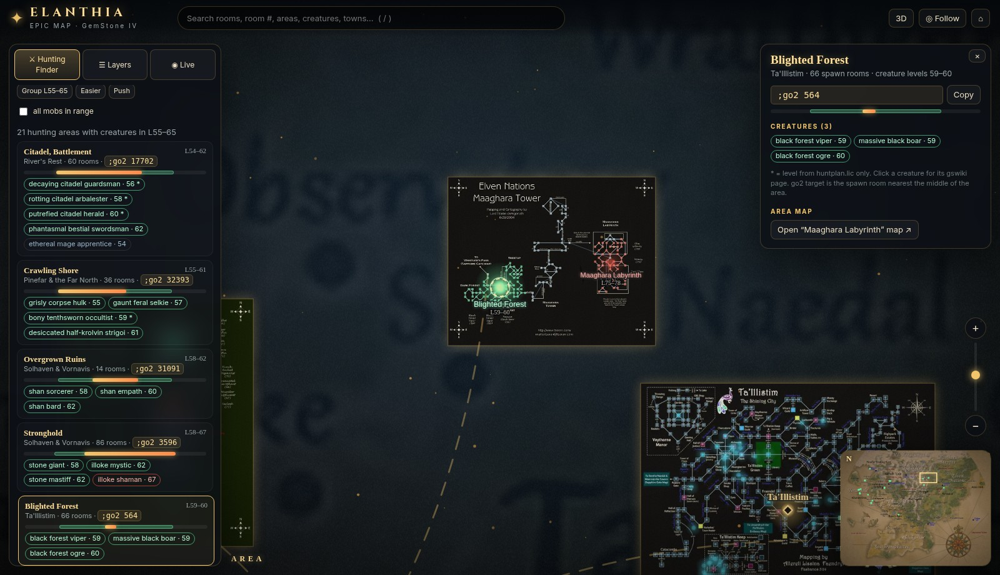

# EpicMap

Interactive GemStone IV world map with connected areas, hunting level filters, live character tracking, fading movement trails, and customizable map layers. Works with Lich.

[Download the latest release](https://github.com/WIdowDark30/EpicMap/releases/latest)

## Windows quick start (1.2.6)

**Use v1.2.6. It fixes the v1.2.5 installation problem**, including map assets nested at `Lich5/EpicMap/EpicMap/index.html`. Existing v1.2.5 users should install this complete package to update both the map files and Lich companion.

1. [**Download EpicMap v1.2.6 — complete Windows ZIP**](https://github.com/WIdowDark30/EpicMap/releases/download/v1.2.6/epicmap-v1.2.6-windows.zip). This is the current release and fixes the installation problems in v1.2.5.
2. Right-click the ZIP → **Extract All**. Open the extracted folder and double-click **Install-EpicMap.cmd**.
3. The installer finds Lich on your Desktop, Documents, Downloads, and OneDrive, including nested folders. If you have several copies, choose the one you actually use. If none is found, paste your Lich folder path.
4. In game run `;epicmap`. If it is already running, first run `;kill epicmap`. Other characters use `;epicmap noopen`. Reload an existing browser tab with **Ctrl+F5**.

No administrator access is normally needed. The installer copies the complete map and launcher, preserves unrelated files, and makes an `epicmap-backup-*` folder in Lich before replacing existing files. Browser preferences and character tracking data are kept. A failed copy reports the backup location; restore that backup before retrying if needed.

Only run the installer downloaded from this repository. Windows may show a warning for unsigned downloaded scripts; review the files before choosing to run them. The command wrapper permits this local PowerShell script for that process only.

### Custom folders and manual installation

For a custom Lich location, run PowerShell from the extracted folder:

```powershell
powershell.exe -NoProfile -ExecutionPolicy Bypass -File .\install.ps1 -LichPath "D:\Games\Lich5"
```

Or copy the included **EpicMap** folder into your Lich folder and copy **scripts/epicmap.lic** into **Lich5/scripts**. Keep all map images, data and credits. The GitHub **Source code** ZIP and the older **update** ZIPs are not complete installations.

The launcher recognizes nested extracted map folders up to three levels deep. To keep maps elsewhere, run `;epicmap dir="D:\My Maps\EpicMap"`. A valid override is saved to **Lich5/data/epicmap/config.json** and used by subsequent launches and characters. Use `;epicmap resetdir` to return to automatic discovery. An invalid override is rejected without replacing the saved setting.

### Troubleshooting

- **Missing index.html / incomplete map:** extract the complete Windows ZIP and run its installer. A lone index.html or update ZIP is insufficient.
- **Saved folder moved:** run `;epicmap dir="NEW PATH"` or `;epicmap resetdir`.
- **Wrong Lich detected:** run the installer again with `-LichPath` for the Lich installation you use to log in.
- **Access denied:** choose a writable Lich installation or close programs locking its files, then retry. Existing files are backed up before replacement.
- **No live tracking:** restart the companion on each character. The first character hosts the local map; others use `;epicmap noopen`.
- **Port conflict:** use `;epicmap port=7444` on all characters and open the address printed by the launcher.

### Build and verification

This repository holds the complete package: the map application in **EpicMap**, the Lich launcher in **scripts**, the Windows installer and the regression tests. Run the checks with Node 20 or later and Ruby:

```bash
npm ci
npx playwright install chromium
npm run check && npm test && npm run test:browser
ruby tests/launcher_test.rb
pwsh -File tests/installer_test.ps1
```

Releases are built by GitHub Actions from the repository. To publish one, bump `version` in **package.json**, add its section to **CHANGELOG.md** and update this README and **UPDATE.txt**. After merging to `main`, push a `vX.Y.Z` tag or run the **Release** workflow from the Actions tab. The workflow runs every test, including the installer checks on Windows. It then builds **epicmap-vX.Y.Z-windows.zip** and **SHA256SUMS.txt** and publishes the release with notes generated from the changelog. Every pull request builds the same package as a dry run. Files marked `export-ignore` in **.gitattributes** stay out of the ZIP.

## New in 1.2.5

- **Illustrated world overview:** new shaded terrain, forests, rivers and coastlines, with crisp labels drawn separately. Choose Illustrated atlas, Minimal vector atlas, or Original artwork under **Layers > World background**. The choice is saved with your preferences. Addresses [#1](https://github.com/WIdowDark30/EpicMap/issues/1).
- **Zoom stays put:** following between maps and opening another local area map retain your chosen zoom. Optional zoom-to-room applies only when enabling Follow. Addresses [#2](https://github.com/WIdowDark30/EpicMap/issues/2).
- **Drag without losing Follow:** panning no longer disables Follow or changes the selected character. Tracking yields while you drag or pinch, then resumes on the next character move. Press **F** or click Follow to pause intentionally. Addresses [#3](https://github.com/WIdowDark30/EpicMap/issues/3).
- Includes the wider zoom range, saved preferences and independent panel controls. The Lich companion, detailed maps and room coordinates are unchanged.

The new illustration is AI-assisted decorative artwork based on the credited Simutronics map, not new official geography or route data. Original artwork remains available. All 13 offline regression tests and six headless-browser check groups passed.

### Saved preferences

Open **Layers → Preferences** to enable or disable automatic saving, **Save now**, or **Reset preferences**. Remembering is enabled by default and saves hunting filters, map layers, view and tilt, tracking controls, selected character, trail duration, selected tab, and panel visibility. Turning it off clears saved settings. Preferences stay in the same browser and site address; they do not sync between computers.

### Panel controls

- Hide the left controls and minimap independently; small Show buttons restore them.
- Press **B** for controls or **M** for the minimap when not typing.
- Visibility is remembered when browser storage is available. Hunting filters, glow, and live tracking continue while panels are hidden.

## Screenshots

### World map
Explore Elanthia and see hunting areas highlighted for your selected level range.


### Hunting finder
Filter hunting areas by level and region, inspect creatures, and copy a `;go2` command.



### Live character tracking
Follow multiple characters and see their recent movement trails through the Lich companion script.


### Tilted view
Switch to a tilted perspective to explore how towns and area maps connect.


The world overview screenshot shows v1.2.5; the other examples are from v1.2.1. Visible layers and settings can differ from the default view. Map artwork and data credits are included in the release README.
