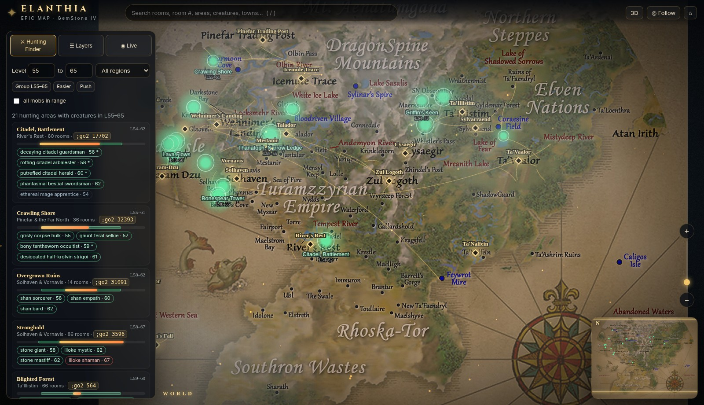
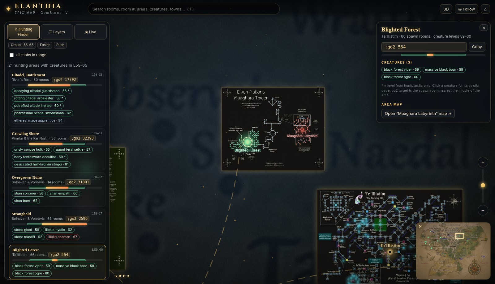
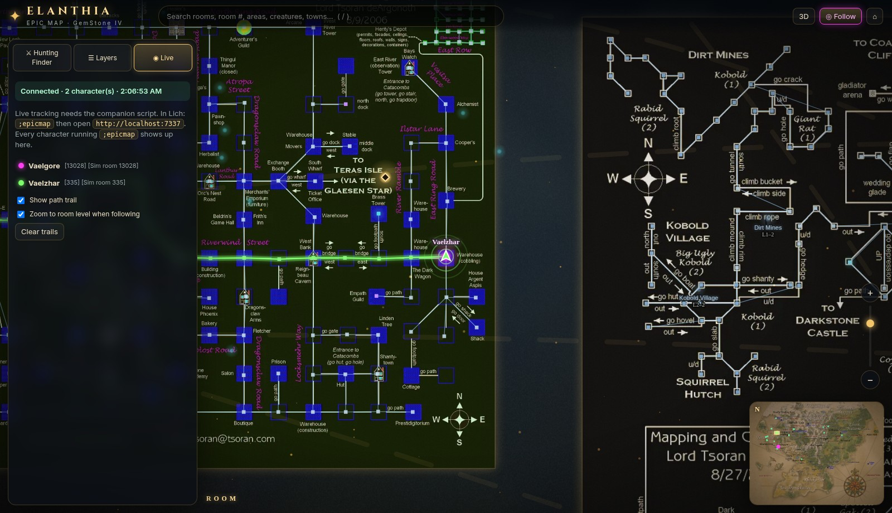
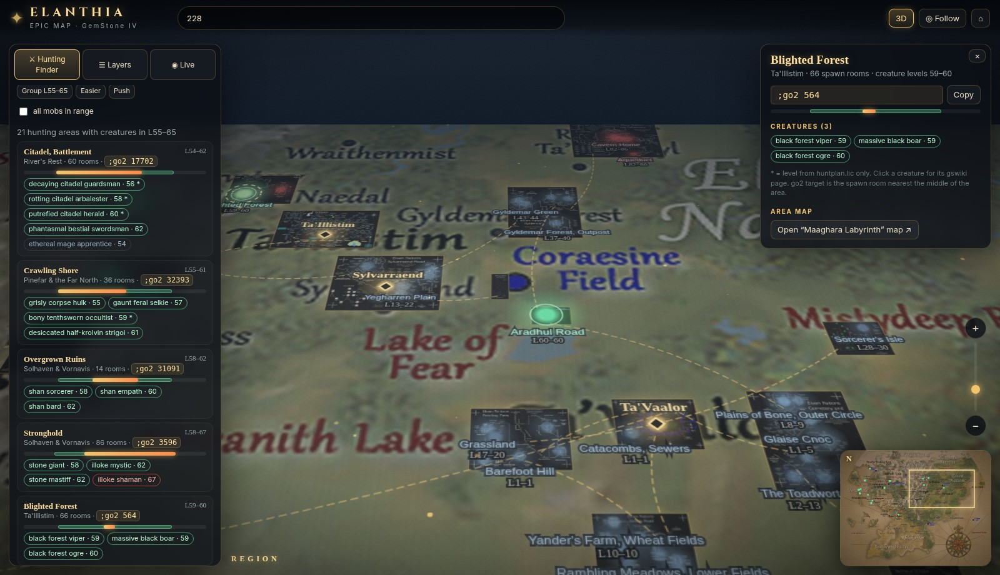

# EpicMap

Interactive GemStone IV world map with connected areas, hunting level filters, live character tracking, fading movement trails, and customizable map layers. Works with Lich.

[Download the latest release](https://github.com/WIdowDark30/EpicMap/releases/latest)

## Download and install v1.2.3

[**Download EpicMap v1.2.3 — complete ZIP**](https://github.com/WIdowDark30/EpicMap/releases/download/v1.2.3/epicmap-v1.2.3.zip)

Includes all maps, data, the Lich companion script, and the latest UI improvements. New users need only this download.

1. Extract the ZIP and place the `EpicMap` folder in your Lich folder.
2. Copy `scripts/epicmap.lic` into your Lich scripts folder.
3. Run `;epicmap` in game. Use `;epicmap noopen` for additional characters.

Existing users can replace their `EpicMap` folder and reload with **Ctrl+F5**.

### Saved preferences

Open **Layers → Preferences** to enable or disable automatic saving, **Save now**, or **Reset preferences**. Remembering is enabled by default and saves hunting filters, map layers, view and tilt, tracking controls, selected character, trail duration, selected tab, and panel visibility. Turning it off clears saved settings. Preferences stay in the same browser and site address; they do not sync between computers.

### Panel controls

- Hide the left controls and minimap independently; small Show buttons restore them.
- Press **B** for controls or **M** for the minimap when not typing.
- Visibility is remembered when browser storage is available. Hunting filters, glow, and live tracking continue while panels are hidden.

## Screenshots

### World map
Explore Elanthia and see hunting areas highlighted for your selected level range.

### Hunting finder
Filter hunting areas by level and region, inspect creatures, and copy a `;go2` command.

### Live character tracking
Follow multiple characters and see their recent movement trails through the Lich companion script.

### Tilted view
Switch to a tilted perspective to explore how towns and area maps connect.

Screenshots are included from the v1.2.1 package; visible layers and settings can differ from the default view. Map artwork and data credits are included in the release README.
